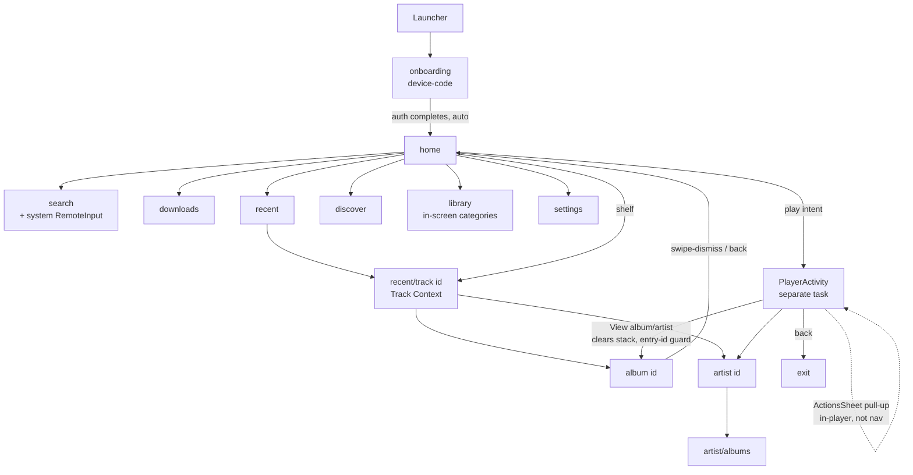

# Navigation graph (2026-11-01)

## Mechanisms

- Main graph: `rememberSwipeDismissableNavController` +
  `SwipeDismissableNavHost` (Wear Compose navigation). Library categories and
  search entry/results are internal state, not routes.
- Player is a separate Activity/task with its own BackHandlers; in-player
  sheets are not nav destinations.
- Player→detail handoff: route request clears MainActivity back stack,
  records the player return entry id; guarded `BackHandler` finishes
  MainActivity when that id is current (UXC-007: swipe-dismiss vs Back may
  diverge — untested).

## Live-verified behavior (2026-11-01, physical watch)

- Back key from search-entry → home; from settings → home (exit path: 3 Backs
  from keyboard = keyboard → search → home → app exit; app exit on third Back
  is expected Wear behavior but easy to hit by accident).
- Edge-swipe back works on Library and Settings surfaces.
- On the system input surface (search), a mid-height left-edge swipe was
  captured by the keyboard's swipe-typing (typed word registered) instead of
  navigating — journeys must use KEYCODE_BACK or keyboard-free areas.

## Known graph friction

- Settings/Discover/Library/Downloads are only reachable by scrolling Home's
  Explore list (depth 1 + scroll); no tile/complication entry points (UX-012).
- From player to a setting change: return home first (no shortcuts).
- Home scroll position persists across app-exit/re-entry (observed; neither
  good nor bad, must be assumed by journeys).
- "Plays from TIDAL" is the intentional Home footer (`HomeFooter`,
  MainActivity.kt:786) — always present at the end of Home; not a state label.
